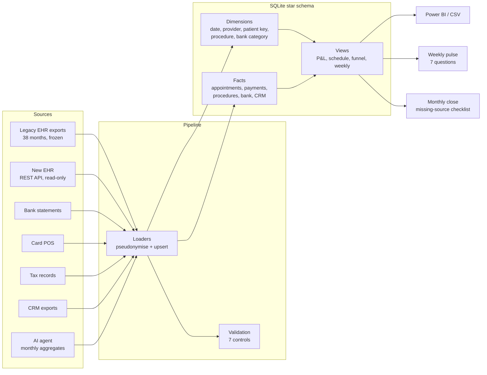
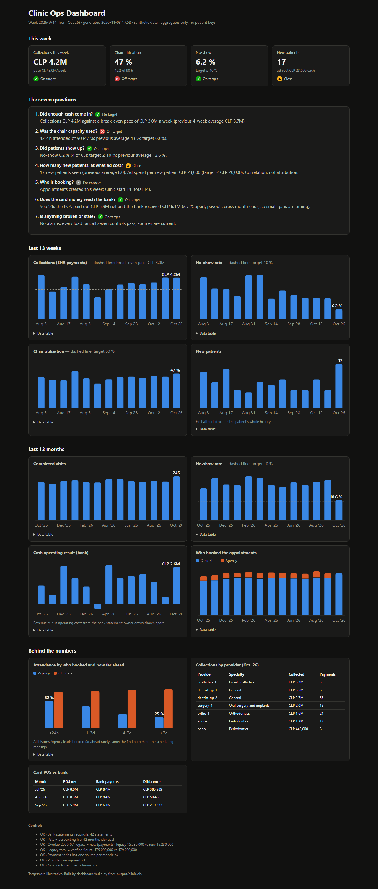

# Clinic Ops Analytics

A pseudonymised data platform for a small outpatient dental clinic: EHR, bank, card payments, tax
records, CRM and an AI patient-messaging agent in one star-schema database, with data-quality controls,
BI-ready views and an automated weekly pulse.

This repository is the **public, runnable replica** of a system I designed and operate in my own clinic
(2 chairs, team of 10, southern Chile). The real system runs on real data; this one runs on
**synthetic data** with the same design, so anyone can rebuild it end to end in seconds.

> **Status:** pipeline, synthetic clinic and dashboard are done and tested; the case study is next.
> See [the roadmap](#roadmap).

## Why it exists
I founded the clinic in 2023 and run it as owner, clinical director, administrator and dentist. Over three
years it went through six operating models, from "the owner does everything" to an AI agent configured,
measured and owned by the clinic. The turning point was a vendor AI chatbot we could not inspect:
**without owned data, written rules and measurement, you cannot evaluate or fix an AI system.**
This platform is the "owned data and measurement" part.

## What it measured (real clinic)
| Metric | Before | After |
|---|---|---|
| No-show rate | 21.8 % (Jan–Sep 2026) | **9.9 %** (Oct 2026) |
| Completed visits / month | 209 (Jan–Sep 2026) | **245 (+17 %)** (Oct 2026) |
| Physical chair utilisation | 32–40 % (Jan–Sep 2026) | **50 %** (Oct 2026) |
| Monthly marketing spend, cash (ads + agency fee) | average Jan–Jul 2026 | **−30 %** (Sep 2026, agency fee cut) |

*Caveats:* the "after" column is a single month against a nine-month baseline, with no control group and no
significance test, so it may regress. The gains come from a redesigned human scheduling workflow and from
cutting the agency fee, not from the AI agent (not yet live with patients). This platform did not cause them:
it is what made the problems visible and what measures the change every day. Full context in the case study
(coming).

## Architecture

The diagram is the production system. This repository replicates all of it on synthetic data except three
pieces: the new EHR's HTTP client (the loader reads JSON saved in the API's shape), the tax records and the
monthly close.

## Design decisions
Short version below; reasoning and trade-offs in [`docs/decisions.md`](docs/decisions.md).
1. **No direct identifiers, by construction.** Patients are a salted HMAC of their national ID; phones are
   hashed the same way to join CRM and EHR. No names, IDs, emails, addresses or message text. Birth year,
   sex, municipality and insurance plan are kept for analysis: those are quasi-identifiers, so the warehouse
   is pseudonymised, not anonymous, and stays personal data under Chile's Law 21.719.
2. **Never delete a row.** Every load is an upsert on a natural key; when a source disappears, the last
   snapshot survives.
3. **One explicit migration cut-over date.** Before it the legacy EHR is the source of truth, after it the
   new one. Overlapping tables carry an `in_series` flag so BI never double counts.
4. **One appointment-status vocabulary** across both EHRs (`attended`, `no_show`, `rescheduled`,
   `cancelled`, `booked`, `block`), instead of trusting each vendor's attendance field.
5. **The database is derived; the sources are the truth.** One command rebuilds it from scratch.
6. **Controls before reports.** Seven controls run after every load, from "bank statements reconcile to
   the peso" to "no column is named like a direct identifier". Any failure blocks reporting.

## Repository layout
| Path | What it does |
|---|---|
| [`pipeline/schema.sql`](pipeline/schema.sql) | Star schema: dimensions, facts, load log |
| [`pipeline/views.sql`](pipeline/views.sql) | Semantic layer: P&L, schedule, attendance by lead time, card reconciliation, CRM funnel, weekly board |
| [`pipeline/common.py`](pipeline/common.py) | Pseudonymisation, normalisers, provider resolution, upsert, load log |
| `pipeline/load_*.py` | One loader per source: legacy EHR (CSV), new EHR (API JSON), bank, card, CRM, ads, AI agent |
| [`pipeline/validate.py`](pipeline/validate.py) | The seven controls |
| [`pipeline/build.py`](pipeline/build.py) | Rebuild everything and export for BI |
| [`synthetic/generate.py`](synthetic/generate.py) | The synthetic clinic: writes every source in the exact format the loaders read |
| [`dashboard/build.py`](dashboard/build.py) | Management dashboard and the weekly pulse (seven questions), from aggregates only |
| [`run.py`](run.py) | One command: generate, rebuild from scratch, run the controls, build the dashboard |
| [`tests/`](tests/) | 20 tests: a hand-built micro clinic pinning each design decision, plus the synthetic clinic's calibration and fault detection |

## Run it
Python 3.10+ and the standard library only. A few seconds on a laptop.
```bash
python run.py                         # synthetic clinic (seed 42) -> warehouse, controls, BI CSVs, dashboard
python run.py --faults                # three injected data faults: the controls fail and no dashboard is built
python -m unittest discover tests     # 20 tests
```

## Synthetic data
`synthetic/generate.py` invents a 2-chair clinic with a team of 10 over 42 months: patients, both EHRs
(legacy CSV exports with their quirks, new EHR in API JSON), bank statements, card POS, agency CRM, weekly
ad reports and the vendor chatbot's dashboard. People are fictional (native Chilean tree names), and IDs and
phones are random. Nothing is copied from the real clinic.

What is calibrated is the **shape**: the attendance model (`ATTEND` in the generator) was tuned until the
synthetic clinic reproduces the aggregate rates of the real case study.

| Rate | Real clinic | Synthetic (seed 42) |
|---|---|---|
| No-show, Jan–Sep 2026 | 21.8 % | 19.9 % |
| No-show, Oct 2026 (after the scheduling redesign) | 9.9 % | 10.6 % |
| Completed visits per month, before → after | 209 → 245 | 219 → 245 |
| Agency-booked first visits that showed up | 37 % | 36.4 % |
| Agency leads attending, booked <24 h → >7 days ahead | 66 % → 26 % | 62 % → 25 % |

Money figures and the timeline are illustrative, not the clinic's. Tests check these rates against bands, so
a change to the model that breaks the shape fails the build.

`--faults` corrupts the data the way real sources fail: a bank line missing from an export, a new hire
missing from `providers.csv`, and a migrated payment edited after the cut-over. Four controls fail and the
run exits with code 1. A control that has never been seen failing proves nothing.

## Dashboard
`output/dashboard/index.html` is a single self-contained page built from the warehouse views: one small
inline script for tooltips, and nothing loaded from the internet (no external scripts, fonts or data). It opens with the **seven questions** the owner answers every
Monday, each with a status and the number behind it:

1. Did enough cash come in? 2. Was the chair capacity used? 3. Did patients show up? 4. How many new
patients, at what ad cost? 5. Who is booking? 6. Does the card money reach the bank? 7. Is anything broken
or stale?

Below them: 13 weeks and 13 months of trends, attendance by who booked and how far ahead, collections by
provider, and card POS against the bank. Every chart has a data table. The same answers are written to
`output/pulse/<week>.md` for the weekly review. The dashboard holds aggregates only (a test checks that no
patient key reaches it), and **it is not built when any control fails**: an old dashboard left next to bad
data would still be read.



## Roadmap
- [x] Repository skeleton, design decisions
- [x] Sanitised pipeline: schema, views, pseudonymisation, loaders, validation, tests
- [x] Synthetic data generator calibrated on the clinic's aggregate rates
- [x] Dashboard and weekly pulse on synthetic data
- [ ] Case study

## About me
Dentist (Chile, 2017). Co-founder and clinical director of a first clinic (2019–2022), then founder of the
clinic this system runs in (2023). I work at the intersection of clinical operations, data and AI
implementation. English C2 (EF SET, reading and listening).
Built with AI-assisted development (Claude Code); the design, rules and decisions are mine.
